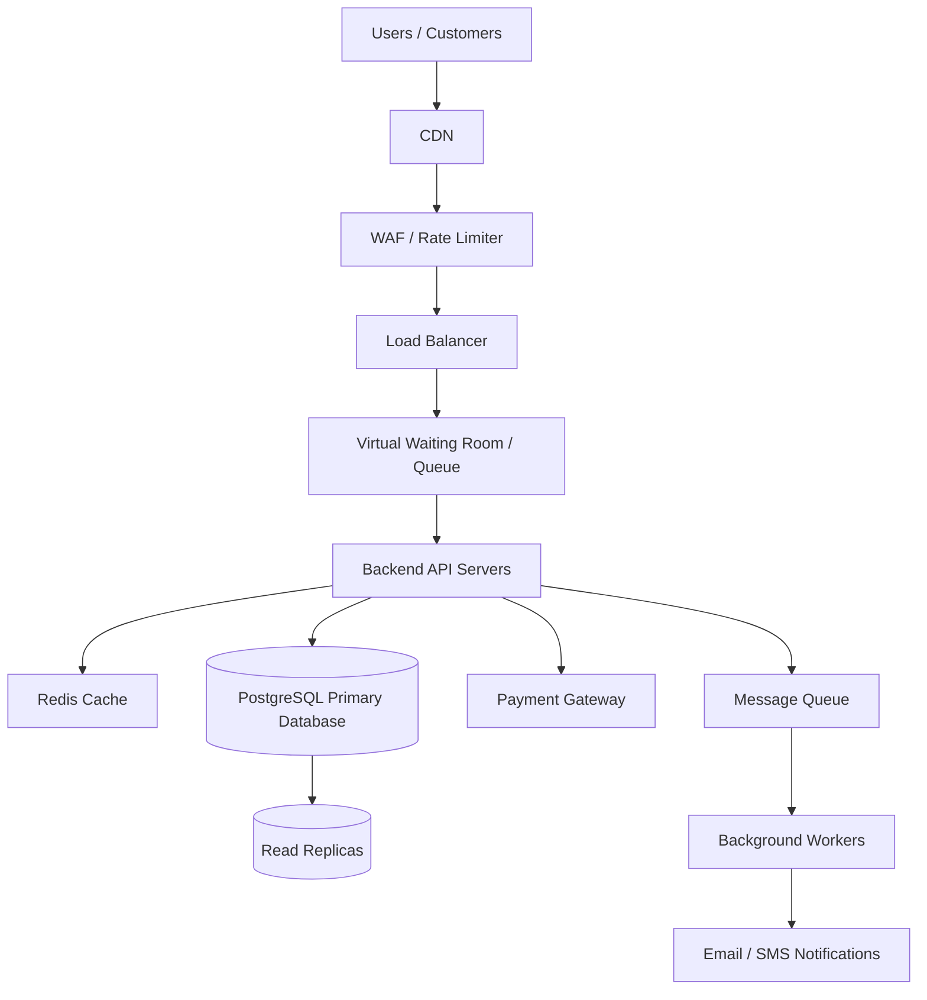

# TicketHub System Design

## Overview

TicketHub is an online ticketing platform that allows users to discover events, view available seats, purchase tickets and manage their bookings. The platform supports concerts and other events, allowing users to browse event information, select seats and make secure payments.

The system is designed to support both normal daily traffic and sudden increases in demand when popular concerts go on sale. Its main priority is to provide a reliable and fair purchasing experience while ensuring that the same seat cannot be sold to multiple customers.

# 1. Requirements

## 1.1 Functional Requirements

The system should allow users to:

1. Register, log in and manage their accounts.
2. Browse upcoming concerts and events.
3. Search and filter events by name, location, date and category.
4. View event details, ticket prices and available seats.
5. View the seating arrangement and select available seats.
6. Temporarily hold selected seats while completing checkout.
7. Make payments securely for reserved tickets.
8. Receive booking confirmation after successful payment.
9. View and access purchased tickets.
10. View their order and payment history.

Administrators should be able to:

1. Create, update and remove events.
2. Manage event seating arrangements.
3. Set ticket prices and ticket availability.
4. Monitor ticket sales and bookings.

## 1.2 Non-Functional Requirements

The system should meet the following quality requirements:

| Requirement | Description |
|---|---|
| Performance | Event pages should load within approximately 2 seconds under normal traffic. |
| Scalability | The platform should handle sudden increases in traffic during popular concert sales. |
| Correctness | A seat must never be sold to two different customers. |
| Fairness | Users should have a fair opportunity to purchase tickets, with temporary seat holds and an orderly queue during high-demand sales. |
| Availability | The system should remain operational during high-traffic periods. |
| Security | User accounts, personal information and payment transactions must be protected. |
| Reliability | Orders and payment records should remain consistent even when transactions fail or users lose connectivity. |
| Data Integrity | Database constraints and transactions must prevent duplicate bookings and invalid seat reservations. |

# 2. Traffic Estimates

The system has 2 million registered users. Traffic estimates are based on normal daily activity and a popular concert sale.

## 2.1 Normal Daily Traffic

Given:

- Registered users: 2,000,000
- Daily visitors: 50,000
- Pages viewed per visitor: 10
- Tickets sold per day: 5,000
- Seconds in a day: 86,400

**Page Views Per Day**

50,000 visitors × 10 pages = 500,000 page views per day.

**Average Requests Per Second**

500,000 ÷ 86,400 = 5.79 page views per second.

**Average Ticket Sales Per Second**

5,000 ÷ 86,400 = 0.058 tickets per second.

This means that under normal conditions, the system handles approximately 6 page views per second and processes 5,000 ticket sales daily.

## 2.2 Popular Concert Sale Traffic

Given:

- People attempting to purchase tickets: 200,000
- Available seats: 20,000
- Time window: 10 minutes (600 seconds)

**Average Purchase Attempts Per Second**

200,000 ÷ 600 = 333.33 attempts per second.

**Available Seats Per Second**

20,000 ÷ 600 = 33.33 seats per second.

**Demand Compared to Supply**

200,000 ÷ 20,000 = 10 people competing for every seat.

Only 10% of the people attempting to purchase tickets can obtain a seat.

## 2.3 Traffic Comparison

| Metric | Normal Day | Popular Concert Sale |
|---|---:|---:|
| People visiting or attempting purchase | 50,000/day | 200,000/10 minutes |
| Time period | 86,400 seconds | 600 seconds |
| Average traffic per second | 0.58 visitors | 333.33 purchase attempts |
| Page views | 500,000/day | Not specified |
| Tickets available or sold | 5,000/day | 20,000 seats |
| Competition | Normal demand | 10 people per seat |

The popular concert sale creates a much greater demand in a very short period. The system must therefore support high concurrency, control incoming traffic and protect the database from being overwhelmed.

The purchase-attempt rate is approximately 57 times the normal daily page-view rate. This comparison is indicative because page views and purchase attempts are different types of requests.

# 3. API Design

The API allows the frontend to communicate with the backend and perform operations such as browsing events, selecting seats and purchasing tickets.

The system will use REST API endpoints and JSON for sending and receiving data.

| Method | Endpoint | Description |
|---|---|---|
| GET | /api/events | Retrieve a list of available events. |
| GET | /api/events/{eventId} | Retrieve details of a specific event. |
| GET | /api/events/{eventId}/seats | Retrieve the seating arrangement and seat availability for an event. |
| POST | /api/holds | Temporarily reserve selected seats for a user. |
| POST | /api/orders | Create an order using successfully held seats. |
| POST | /api/payments | Process payment for an order. |
| GET | /api/tickets | Retrieve tickets belonging to the authenticated user. |
| GET | /api/orders/{orderId} | Retrieve details and status of a specific order. |

## API Explanation

**1. Browse Events**

`GET /api/events`

Returns available events with information such as event name, date, location and ticket prices.

**2. View Event Details**

`GET /api/events/{eventId}`

Returns detailed information about a selected event.

**3. View Available Seats**

`GET /api/events/{eventId}/seats`

Returns the seating arrangement and current availability of seats.

**4. Hold Seats**

`POST /api/holds`

Temporarily reserves selected seats for a user. A successful hold prevents other users from reserving those seats during the holding period.

**5. Create an Order**

`POST /api/orders`

Creates an order using seats that have been successfully held by the user.

**6. Process Payment**

`POST /api/payments`

Processes payment for an order and updates its payment and booking status.

**7. View Purchased Tickets**

`GET /api/tickets`

Returns the authenticated user's purchased tickets.

**8. View Order Details**

`GET /api/orders/{orderId}`

Returns the details and current status of an order.

All purchasing endpoints require authentication. Payment requests should use idempotency keys to prevent duplicate charges when a user retries a request.

# 4. Database Design

TicketHub will use a relational database such as PostgreSQL because ticket purchasing requires reliable transactions, relationships and data integrity.

The database will contain at least four main tables.

## 4.1 Users Table

Stores information about registered users.

| Column | Data Type | Description |
|---|---|---|
| user_id | INTEGER (PK) | Unique user identifier. |
| full_name | VARCHAR | User's full name. |
| email | VARCHAR (UNIQUE) | User's email address. |
| password_hash | VARCHAR | Hashed user password. |
| created_at | TIMESTAMP | Account creation date. |

## 4.2 Events Table

Stores information about concerts and other events.

| Column | Data Type | Description |
|---|---|---|
| event_id | INTEGER (PK) | Unique event identifier. |
| event_name | VARCHAR | Name of the event. |
| location | VARCHAR | Event venue or location. |
| event_date | TIMESTAMP | Date and time of the event. |
| description | TEXT | Event description. |
| status | VARCHAR | Event status, such as upcoming or completed. |

## 4.3 Seats Table

Stores the seats available for each event.

| Column | Data Type | Description |
|---|---|---|
| seat_id | INTEGER (PK) | Unique seat identifier. |
| event_id | INTEGER (FK) | References the Events table. |
| seat_number | VARCHAR | Seat identification number. |
| price | DECIMAL | Price of the seat. |
| status | VARCHAR | Available, held or sold. |
| hold_expires_at | TIMESTAMP | Expiration time of a temporary seat hold. |
| hold_user_id | INTEGER (FK) | References the user holding the seat; nullable. |

A unique constraint should be placed on `(event_id, seat_number)` to ensure that the same seat number cannot be created more than once for an event.

## 4.4 Orders Table

Stores ticket purchase information.

| Column | Data Type | Description |
|---|---|---|
| order_id | INTEGER (PK) | Unique order identifier. |
| user_id | INTEGER (FK) | References the Users table. |
| total_amount | DECIMAL | Total order amount. |
| order_status | VARCHAR | Pending, confirmed, cancelled or expired. |
| payment_status | VARCHAR | Pending, successful or failed. |
| created_at | TIMESTAMP | Order creation date. |

## 4.5 Order Items Table

An additional table is needed to connect orders to individual seats. This allows one order to contain multiple tickets.

| Column | Data Type | Description |
|---|---|---|
| order_item_id | INTEGER (PK) | Unique order item identifier. |
| order_id | INTEGER (FK) | References the Orders table. |
| seat_id | INTEGER (FK, UNIQUE) | References the Seats table. |
| ticket_code | VARCHAR (UNIQUE) | Unique ticket identification code. |

## 4.6 Table Relationships

The database relationships are as follows:

1. One user can create many orders (one-to-many).
2. One event can have many seats (one-to-many).
3. One order can contain multiple order items (one-to-many).
4. Each order item refers to one seat.
5. Each seat belongs to one event.
6. A user can temporarily hold multiple seats, but each seat can only have one active holder at a time.

The relationships use primary keys and foreign keys to maintain referential integrity.

# 5. Preventing Double-Booking

One of the most important requirements of TicketHub is ensuring that two customers cannot purchase the same seat.

This is particularly important during a popular concert sale when 200,000 people may attempt to purchase only 20,000 available seats.

The system will use database transactions, constraints and temporary seat holds to prevent double-booking.

## 5.1 Temporary Seat Holds

When a user selects a seat, the backend attempts to place a temporary hold on it.

For example:

- User A selects seat A10.
- The backend checks whether seat A10 is available.
- If available, the system changes its status to `held`.
- The system records the user holding the seat and an expiration time, such as 10 minutes.
- Other users cannot successfully hold or purchase that seat while the hold is active.

If the user completes payment within the holding period, the seat becomes `sold`.

If the user does not complete payment before the expiration time, the hold expires and the seat becomes available again.

## 5.2 Database Transactions

The system will use database transactions to ensure that seat reservation operations are completed safely.

For example, when two users attempt to reserve the same seat simultaneously:

1. User A and User B both request seat A10.
2. The backend starts a database transaction for each request.
3. The database locks the selected seat row using `SELECT ... FOR UPDATE`.
4. User A obtains the lock first.
5. The system checks that the seat is available and changes its status to `held`.
6. User A's transaction is committed.
7. User B's transaction proceeds and discovers that the seat is already held.
8. User B's request is rejected.

This prevents both users from successfully reserving the same seat.

## 5.3 Database Constraints

The system will also use database constraints as an additional layer of protection.

- Primary keys ensure that every record has a unique identifier.
- Foreign keys ensure that orders reference valid users and seats.
- A unique constraint on `(event_id, seat_number)` prevents duplicate seat records.
- A unique constraint on `seat_id` in the Order Items table prevents the same seat from appearing in multiple orders.

The seat status and order records must also be updated within appropriate transactions.

## 5.4 Payment and Booking Confirmation

Payment processing introduces another potential problem. A payment provider may respond slowly or the user may lose connectivity after making payment.

To handle this:

1. The system creates an order for the held seats.
2. The payment provider processes the transaction.
3. The backend verifies the payment result.
4. If payment succeeds, the order is confirmed and the seats are marked as sold.
5. If payment fails, the order is not confirmed and the seats are released according to the hold and payment rules.
6. Idempotency keys prevent duplicate payment processing when requests are retried.

The system should also handle delayed payment confirmations and avoid releasing seats while a payment is still being verified.

By combining temporary holds, row-level locking, database transactions and unique constraints, TicketHub can prevent double-booking even when many users attempt to purchase the same seat simultaneously.

# 6. System Architecture

TicketHub will use a scalable, multi-layered architecture to support normal traffic and large increases in demand during popular concert sales.

## 6.1 Architecture Diagram

## 6.2 Architecture Components

**1. Users / Customers**

Customers access TicketHub through a web browser or mobile device to browse events, select seats and purchase tickets.

**2. Content Delivery Network (CDN)**

The CDN delivers static content such as images, stylesheets and JavaScript files from servers closer to users. This reduces the workload on the main application servers.

**3. Web Application Firewall (WAF) and Rate Limiter**

The WAF helps protect the platform against malicious traffic. Rate limiting restricts excessive requests from individual users or clients to prevent abuse and reduce unnecessary load.

**4. Load Balancer**

The load balancer distributes incoming requests across multiple backend servers. This prevents one server from handling all the traffic.

**5. Virtual Waiting Room / Queue**

During a popular concert sale, users are placed in a virtual waiting room. The system controls how many users are allowed into the purchasing process at a time.

This helps manage the 200,000 purchase attempts and prevents the backend and database from being overwhelmed. A fair queueing policy should prevent users from gaining an unfair advantage through repeated requests.

**6. Backend API Servers**

The backend handles business logic, authentication, event browsing, seat reservations, order creation and payment processing.

Multiple backend servers allow the application to handle more requests as traffic increases.

**7. Redis Cache**

Redis stores frequently requested information such as event details and seating information. This reduces repeated database queries and improves response times.

Seat availability must always be validated against the primary database before a reservation is confirmed. Cached information should not be treated as proof that a seat is still available.

**8. PostgreSQL Primary Database**

The primary database stores users, events, seats and orders. It handles critical operations such as seat reservations and booking confirmations.

Database transactions, row-level locks and unique constraints protect data integrity.

**9. Read Replicas**

Read replicas handle read-heavy operations such as retrieving event information and browsing tickets. This reduces the read workload on the primary database.

Seat reservation and purchase operations must still use the primary database to avoid relying on potentially outdated replica data.

**10. Payment Gateway**

An external payment gateway processes customer payments. The backend verifies payment results before confirming orders.

**11. Message Queue and Background Workers**

The message queue stores tasks that do not need to be completed immediately, such as sending booking confirmations and generating notifications.

Background workers process these tasks independently, reducing the workload on the main application servers.

**12. Email / SMS Notifications**

Customers receive booking confirmations and ticket information after successful purchases.

## 6.3 How the Architecture Handles a Popular Concert Sale

When 200,000 people attempt to purchase 20,000 seats within 10 minutes, the system handles the increased demand as follows:

1. The CDN serves static content without sending every request to the backend.
2. The WAF and rate limiter control abusive or excessive requests.
3. The load balancer distributes incoming requests across multiple backend servers.
4. The virtual waiting room controls how many users enter the purchasing process simultaneously.
5. Redis handles frequently requested event information to reduce database workload.
6. The PostgreSQL primary database manages seat holds and purchases using transactions and row-level locks.
7. Read replicas handle suitable read requests, reducing pressure on the primary database.
8. The payment gateway processes payments independently.
9. Background workers send confirmations without slowing down the purchasing process.

The architecture separates read-heavy operations from critical purchasing operations. This allows TicketHub to remain responsive while protecting the accuracy of ticket availability and purchases.

# 7. Trade-Offs

System design involves making decisions where improving one aspect may introduce limitations in another.

TicketHub has the following trade-offs:

## 7.1 Strong Consistency vs Performance

Using database transactions and row-level locks ensures that seats cannot be sold to multiple customers.

However, locking rows can increase waiting times when many users attempt to reserve the same seats simultaneously.

The system prioritizes correctness over speed during seat reservations because preventing double-booking is more important than processing every request immediately.

## 7.2 Redis Caching vs Data Accuracy

Caching event information and seat availability improves performance and reduces database queries.

However, cached information may become outdated when another user purchases or holds a seat.

To address this, Redis will be used mainly for frequently accessed information, while the primary database will always verify seat availability before confirming reservations.

This introduces additional database queries but protects booking accuracy.

## 7.3 Virtual Waiting Room vs Immediate Access

A virtual waiting room helps control traffic and prevents the backend from becoming overwhelmed during popular sales.

However, customers may have to wait before accessing the purchasing process, which can affect their experience.

The system accepts this trade-off because controlled access is better than allowing everyone to enter simultaneously and risking a complete system failure.

# Conclusion

TicketHub is designed to provide a reliable, secure and scalable ticket purchasing experience.

The system combines a relational database, REST APIs, caching, load balancing, a virtual waiting room and background processing to handle different levels of demand.

Most importantly, temporary seat holds, database transactions, row-level locking and unique constraints prevent two customers from successfully purchasing the same seat.

This design allows the platform to support normal daily operations while remaining reliable during high-demand concert sales.